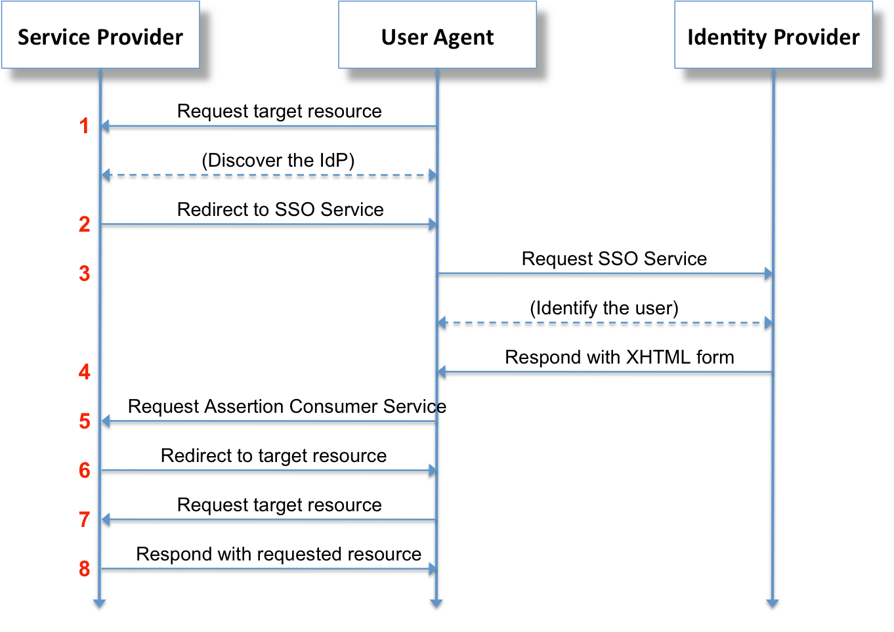
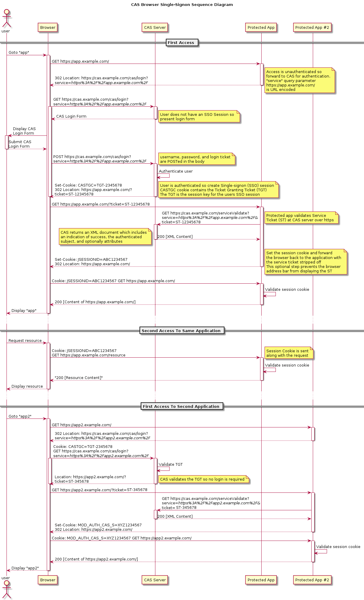

浏览器是不可信的

<!--more-->

# 流程

## 授权

### OAuth 1

可以向无法信任的服务使用方提供授权服务

A: 服务使用方向服务提供方获取 Request Token:

- `oauth_consumer_key`: 明文提供使用方身份
- `oauth_signature_method`: 签名方法
- `oauth_signature`: 签名: key 为向服务提供方注册时保存的 `oauth_consumer_secret` (HMAC) 或 consumer 注册时的私钥 (RSA)
- `oauth_timestamp`: 时间戳
- `oauth_nonce`: 随机数, 防止重放
- `oauth_version`: oauth 版本
- `oauth_callback`: 回调地址

B: 服务提供方返回 Unauthorized Request Token:

- `oauth_token`: 服务提供方保证此 token 在用户授权之前都无法被交换为 access token
- `oauth_token_secret`: 后续 oauth_signature 使用 `percent_encode(oauth_consumer_secret) + "&" + percent_encode(oauth_token_secret)` 作为签名的 key
- `oauth_callback_confirmed`: 1.0a 新增的补丁, 要求实现必须使用 callback, 否则存在安全风险

C\~D: 服务使用方引导用户至服务提供方获取用户同意

E: 服务提供方通知使用方, 向回调地址发送 http 请求:

- `oauth_token`: 此前的 request token
- `oauth_verifier`: 一个验证码, 提供方将其和 oauth_token 绑定, 保证登录的用户和换取 access_token 的用户相同

F~G: 服务使用方以 Request Token 向提供方换取 Access Token:

- Request:
	- `oauth_consumer_key`
	- `oauth_token`
	- `oauth_signature_method`
	- `oauth_signature`: 使用 `percent_encode(oauth_consumer_secret) + "&" + percent_encode(oauth_token_secret)` 作为签名的 key
	- `oauth_timestamp`
	- `oauth_nonce`
	- `oauth_version`
	- `oauth_verifier`
- Response:
	- `oauth_token`: access token, 可以使用资源
	- `oauth_token_secret`

使用资源时需要携带:

- `oauth_consumer_key`
- `oauth_token`: Access Token
- `oauth_signature_method`
- `oauth_signature`
- `oauth_timestamp`
- `oauth_nonce`
- `oauth_version`
- Additional parameters

```text
+----------+                                           +----------+
|          |--(A)- Obtaining a Request Token --------->|          |
|          |                                           |          |
|          |<-(B)- Request Token ----------------------|          |
|          |       (Unauthorized)                      |          |
|          |                                           |          |
|          |      +--------+                           |          |
|          |>-(C)-|       -+-(C)- Directing ---------->|          |
|          |      |       -+-(D)- User authenticates ->|          |
|          |      |        |      +----------+         | Service  |
| Consumer |      | User-  |      |          |         | Provider |
|          |      | Agent -+-(D)->|   User   |         |          |
|          |      |        |      |          |         |          |
|          |      |        |      +----------+         |          |
|          |<-(E)-|       -+-(E)- Request Token ------<|          |
|          |      +--------+      (Authorized)         |          |
|          |                                           |          |
|          |--(F)- Obtaining a Access Token ---------->|          |
|          |                                           |          |
|          |<-(G)- Access Token -----------------------|          |
+----------+                                           +----------+
```

[OAuth 1.0a](https://oauth.net/core/1.0a/)

### OAuth 2

OAuth 2 相较于 OAuth1 将 Service Provider 拆分为了 Resource Server (保存受保护资源、验证 Access Token) 和 Authorization Server (认证用户、获取授权、签发 Token); 去除了签名, 改用 HTTPS 保证消息不被篡改; 允许用户授权自己的服务使用方是否可以使用服务提供方的一部分服务; 并进行了一部分简化

总的来说还是先获取一个 code, 然后再用 code 换取 Access Token, 但是这里 code 是在用户授权之后通过回调地址返回的

A: 服务使用方发起申请

- `response_type` = `code`: 固定字段
- `client_id`: 向服务提供方注册时保存的 id
- `redirect_uri`: 接收 code 的回调地址 (在大部分实践中, 需要和向服务提供方注册的一致)
- `scope`: 请求的资源范围
- `state`: 随机字符串, 用于后续确认请求是自己发起的

B: Authorization Server 验证用户身份并获取用户同意

C: 重定向至回调地址传入授权 code (由于是重定向, 可被前端获取, 因此需要在可信的后端再使用 code 换取 Access Token)

- `code`: 用于换取 Access Token, 此 code 只能使用一次 且短时间内就会过期
- `state`: 原样返回

D: Client 向 Authorization Server 发送 code 换取 Access Token

- Request:
	- `grant_type` = authorization_code
	- `code`
	- `client_id`
	- `client_secret`: 向服务提供方注册时保存的随机字符串 (可选)
	- `redirect_uri`: 用于接收 code 时的回调地址, 地址需与 A C 中的地址相同 (实际上不会加强安全性, 将于 OAuth2.1 变为可选传入)

E: Authorization Server 验证 code 和 client 身份并返回 Access Token

- Response:
	- `access_token`
	- `token_type`
	- `expires_in`
	- `refresh_token`

```text
+----------+
| resource |
|   owner  |
|          |
+----------+
     ^
     |
    (B)
+----|-----+          Client Identifier      +---------------+
|         -+----(A)-- & Redirection URI ---->|               |
|  User-   |                                 | Authorization |
|  Agent  -+----(B)-- User authenticates --->|     Server    |
|          |                                 |               |
|         -+----(C)-- Authorization Code ---<|               |
+-|----|---+                                 +---------------+
  |    |                                         ^      v
 (A)  (C)                                        |      |
  |    |                                         |      |
  ^    v                                         |      |
+---------+                                      |      |
|         |>---(D)-- Authorization Code ---------'      |
|  Client |          & Redirection URI                  |
|         |                                             |
|         |<---(E)----- Access Token -------------------'
+---------+       (w/ Optional Refresh Token)
```

[OAuth 2.0](https://datatracker.ietf.org/doc/html/rfc6749)

## 身份认证和单点登录

### SAML 2

SAML 整体流程相对简单, 因为资源的使用方就是 User Agent, 而不是外部 Client; 只需要 Service Provider 和 Identity Provider 之间对齐就行了

- 1\~2: 用户请求服务, 若发现没有验证过用户身份, 则将 SAML 请求 (可以通过注册时提供的公私钥进行加密) 编码到参数中返回重定向状态到身份验证提供方
- 3\~5: 身份验证提供方将 SAML 响应编码到参数中重定向到服务提供方
- 6\~8: 服务提供方验证身份并根据其权限提供相应的服务



### CAS 7.1

本质是 SSO 的延伸, 依赖 Cookie

服务提供方们通过 Ticket 验证用户的身份; 在和 CAS Server 之间、相同的服务提供商的多次交互中使用 cookie 保持登录状态;

- 1: 第一次使用服务提供商时, 服务提供商会重定向到 CAS Server
- 2: CAS Server 验证 cookie (CASTGC) 有效后给该 User-app 对生成一个 ticket, 并再重定向到服务提供商
- 3: 服务提供商向 CAS Server 验证该 ticket 的有效性后创建并使用该服务的 cookie-session 记录登录状态并提供服务



### OpenID Connect

TODO
