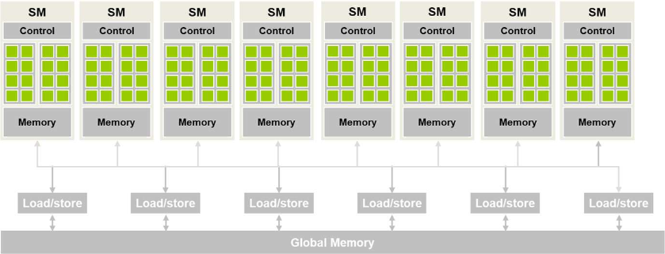
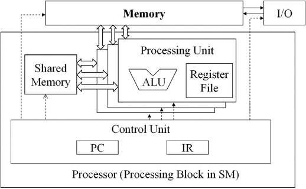
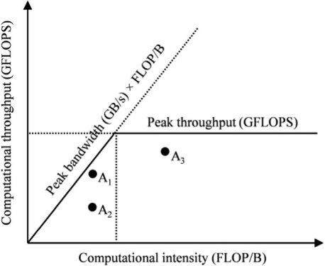
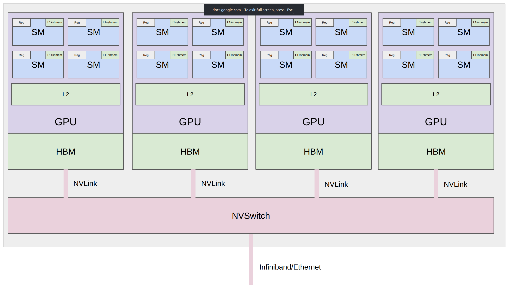
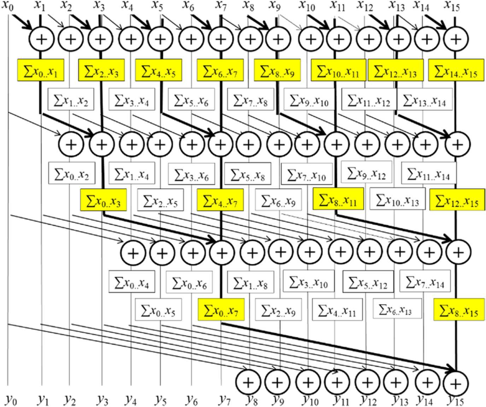
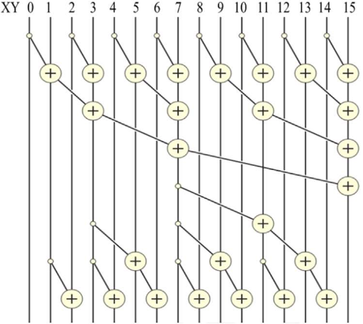
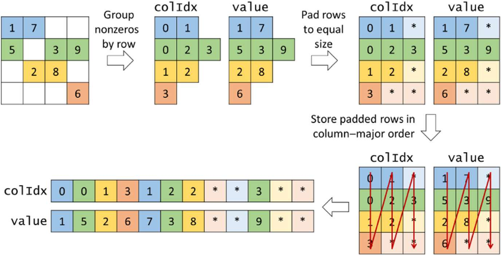
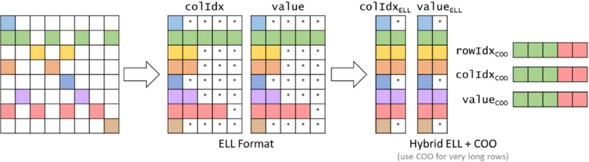
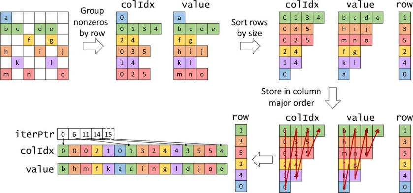

从设计上讲: CPU 面向延迟, GPU 面向吞吐

<!--more-->

# 硬件

## Cuda Core



### grid

#### block 调度

一个 grid 中的 block 执行顺序可以是任意的

#### 全局内存

大几百个 cycle

`__device__` 和 `__constant__` 都存在这

#### L2 Cache

所有 SM 共享

小几百 cycle

### (SM)

#### warp 调度

与 CPU 不同, GPU SM 在切换 warp 的时候不会把寄存器内容转移到 DRAM; SM 的寄存器数量足够多 (太多还是溢出到 DRAM), 可以同时保存这个 SM 上所有 warp 的寄存器; 所以同一个 SM 切换执行哪个 warp 的开销很小

因此一个 SM 通常分配多个 warp, 当前 warp 需要耗时长的阻塞操作时 (例如内存读写), 可以异步执行然后切另一个 warp 保证吞吐 (类似协程, 但是切换成本更低)

#### L1 Cache

和 shared mem 共用一块存储区域, 硬件管理

几十 cycle

### block

block 中的所有线程执行相同的核函数

#### warp 调度

一个 block 中的所有 warp 都会分配给同一个 SM, 这样同一个 block 中线程的同步成本会更低 (`__shared__`、`__syncthreads`)

一个 SM 可以分配多少 block 是有限的, 此外 block 使用的 shared mem、包含的线程使用的寄存器大小、warp context 大小都会限制一个 SM 可以分配多少 block

> 不同分支的 `__syncthreads` 是不同的同步点, 如果一个 block 中一部分线程执行 if 分支的 `__syncthreads`, 另一部分执行 else 分支的, 就会死锁

一个 block 中的 warp 执行顺序可以是任意的

#### shared memory

和 L1 cache 共用一块存储区域, 程序员管理

几十 cycle

### (warp)

调度和发射的最小单位, 包含一些 thread

理论上一个 warp 的大小是硬件定义的, 但是有生之年大概都是 32 吧

warp 算 simd 还是 simt 似乎有不同的看法: 可能在锁步执行的时代, 如果将分支掩码之类的也看做 data, 就更像 simd; volta 之后更像 simt?

这种设计可以节约硬件: 整个 warp 共用指令获取/调度单元



#### 控制发散

volta 之前的控制发散很好理解: 所有分支不管是否满足条件都得执行一遍, 用掩码决定哪些线程使用

volta 之后的 TODO

`__syncwarp`

### thread

实际执行的单位

#### register

1 cycle

需要注意的是, 自动**数组**变量是会被分配在 local memory (HBM 中划分出来的一部分内存, 只有线程内部可见该线程对应的部分) 中的 (但是如果对数组访问的索引都是编译期常量, 也有可能优化到寄存器里)

## Tensor Core

有的时候感觉写 gpu 编程的比 cpu 的更绝望, 搞了半天的优化可能下代产品直接硬件加速一条指令完成了

# 优化

## 访存

说到底都是全局内存太慢了

### roofline



横轴是算数强度, 纵轴是计算吞吐, 斜率是内存带宽

计算吞吐是有上线的 (SM 的数量和频率限制)

一个点到原点连线的斜率就表示他代表的任务的平均占用内存带宽

### occupancy

$$
\text{occupancy} = \frac{\text{active warps}}{\text{max warps}}
$$

限制因素: 

1. Register File
2. Shared Memory
3. 最大 Resident Blocks
4. 最大 Resident Warps


就是让 SM 的候选 warp 尽可能多, 方便 SM 随时可以切另一个就绪 warp 掩盖访存时间

所以不是只要 occupancy 高就万事大吉了, 如果能写个 kernel 完全不访存, 哪怕只有一个 warp 都无所谓

### 合并内存访问

由于内存访问的特性, 我们哪怕访问一个 bit, 也会返回周围一片连续的内存

因此我们应该尽可能让一个 warp 中线程访问的内存区域尽可能集中

```cpp
x = a[threadIdx.x]; // good
x = a[threadIdx.x * 2]; // bad
x = a[threadIdx.x * 3]; // worse
x = a[rand()]; // worst
```

### Tile

我们可以重新设计算法, 对数据分片, 对每片数据尽可能集中用到这片数据的计算, 我们就可以将这些数据放在 shared mem 甚至 register 中来消除等待内存操作的时间

比如矩阵乘法中 block 级别、对矩阵行和列的 Tile: 

```cpp
__global__ void matrix_multiplication_kernel(const float* A, const float* B, float* C, int M, int N, int K) {
  int ans_row = blockIdx.y * TILE + threadIdx.y;
  int ans_col = blockIdx.x * TILE + threadIdx.x;
  __shared__ float a_tile_now[TILE][TILE];
  __shared__ float b_tile_now[TILE][TILE];
  float sum = 0.0;
  for (int t = 0; t < (N + TILE - 1) / TILE; t++) {
    a_tile_now[threadIdx.y][threadIdx.x] = (ans_row < M && (t * TILE + threadIdx.x < N)) ? A[ans_row * N + t * TILE + threadIdx.x] : 0.0;
    b_tile_now[threadIdx.y][threadIdx.x] = ((t * TILE + threadIdx.y) < N && ans_col < K) ? B[(t * TILE + threadIdx.y) * K + ans_col] : 0.0;
    __syncthreads();

    for (int n = 0; n < TILE; n++) {
      sum += a_tile_now[threadIdx.y][n] * b_tile_now[n][threadIdx.x];
    }
    __syncthreads();
  }
  if (ans_row < M && ans_col < K) {
    C[ans_row * K + ans_col] = sum;
  }
}
```

### shared memory bank conflict

这个 bank 和 DRAM 那个 bank 不是一回事

shared memory 组织的比较对程序员透明, 这种组织形式决定了一个 bank 在一个 cycle 只能提供 4 byte (硬件决定, 但是现在一般就是 4 byte)

属于哪个 bank 就是算 $\text{bank\_id} = \left(\frac{\text{byte\_address}}{4}\right) = \text{word\_index} \bmod 32$

```
byte addr: 

 31                 7  6       2  1       0
+--------------------+----------+-----------+
|     Bank Offset    | Bank ID  |Byte Offset|
+--------------------+----------+-----------+
```

然后就是尽量让一次读取的内存尽可能均匀的分布在不同的 bank 上就行了

一般像对矩阵的同一列的访问容易出现这种问题, 可以给矩阵加个 pad 避免是 32 的倍数, 或者用 swizzle

TMA 有自动 swizzle 的功能

### 线程粗化

让一个线程做更多的事情: 比如一个线程不是只处理一个像素, 而是处理一列像素

可以减少调度开销, 减少 index 计算开销, 增加指令并行水平

比如粗化版本的矩阵乘法: 

```cpp
#define TILE_WIDTH 32
#define COARSE_FACTOR 4

__global__ void matrixMulKernel(float* M, float* N, float* P, int width) {
  __shared__ float Mds[TILE_WIDTH][TILE_WIDTH];
  __shared__ float Nds[TILE_WIDTH][TILE_WIDTH];

  int bx = blockIdx.x;
  int by = blockIdx.y;
  int tx = threadIdx.x;
  int ty = threadIdx.y;

  // Identify the row and column of the P element to work on
  int row = by * TILE_WIDTH + ty;
  int colStart = bx * TILE_WIDTH * COARSE_FACTOR + tx;

  // Initialize Pvalue for all output elements
  float Pvalue[COARSE_FACTOR];
  for (int c = 0; c < COARSE_FACTOR; ++c) {
    Pvalue[c] = 0.0f;
  }

  // Loop over the M and N tiles required to compute P element
  for (int ph = 0; ph < width / TILE_WIDTH; ++ph) {
    // Collaborative loading of M tile into shared memory
    Mds[ty][tx] = M[row * width + ph * TILE_WIDTH + tx];

    for (int c = 0; c < COARSE_FACTOR; ++c) {
      int col = colStart + c * TILE_WIDTH;

      // Collaborative loading of N tile into shared memory
      Nds[ty][tx] = N[(ph * TILE_WIDTH + ty) * width + col];
      __syncthreads();

      for (int k = 0; k < TILE_WIDTH; ++k) {
        Pvalue[c] += Mds[ty][k] * Nds[k][tx];
      }
      __syncthreads();
    }
  }

  for (int c = 0; c < COARSE_FACTOR; ++c) {
    int col = colStart + c * TILE_WIDTH;
    P[row * width + col] = Pvalue[c];
  }
}
```

## 同步

### 私有化

加锁修改共享资源不如复制一份修改自己的, 最后再提交一次给共享资源

需要注意的问题和 CPU 的多线程编程类似

## 多卡并行



### 分布式训练

#### 数据并行

每张卡都有完整的模型, 对要处理的输入进行切分

比如并行处理不同 batch

相对简单点, 处理不了参数太大的情况

在训练的时候通常只需要最后算梯度的时候 all reduce 一次

#### 张量并行

每张卡的存模型的一部分, 对参数矩阵本身切分

比如矩阵乘法 $XW$ 就可以把 $W$ 按列切分, 结果为 $\mathrm{Concat}(XW_0, XW_1, \dots XW_{\mathrm{size}(world) - 1})$

模型每层依赖上一层的结果, 所以每层结束都要 all gather 一次

#### 流水线并行

每张卡存模型的一部分层, 按层切分

可以通过重叠通信和计算来消除流水线气泡

# 应用

## 规约

没太多好说的, 注意 block 的 offset 从大到小可以尽可能让 warp 发散晚些出现

```cpp
__global__ void SharedMemorySumReductionKernel(float* input) {
    __shared__ float input_s[BLOCK_DIM];

    unsigned int t = threadIdx.x;
    input_s[t] = input[t] + input[t + BLOCK_DIM];

    for (unsigned int stride = blockDim.x / 2; stride >= 1; stride /= 2) {
        __syncthreads();
        if (threadIdx.x < stride) {
            input[t] += input_s[t + stride];
        }
    }

    if (threadIdx.x == 0) {
        *output = input_s[0];
    }
}
```

一个 warp 内的可以用 shuffle 优化

当然跨 warp 的也可以先规约 warp 内然后再规约 warp 之间

```cpp
__device__ float warp_reduce_sum(float val) {
    for (int offset = 16; offset > 0; offset >>= 1) {
        val += __shfl_down_sync(0xffffffff, val, offset);
    }
    return val;
}
```

## 归并

## 前缀和

### Kogge-Stone

没什么好说的, 和树形规约看上去挺像的, 区别在于每次迭代参与的线程是哪些: 规约在每一轮都把一半的数据计算贡献后抛弃, 而前缀和是每一轮计算完成计算完成了前 $2^{offset}$ 的前缀和, 但是不抛弃这些数据, 后续仍会用到

或者看做类似 st 表和 LCA 的倍增算法, 第 `stride` 轮的第 `i` 项代表 `sum([i - 2**stride, i])`



```cpp
__global__ void Kogge_Stone_scan_kernel(float *X, float *Y, unsigned int N){
    __shared__ float XY[SECTION_SIZE];
    unsigned int i = blockIdx.x*blockDim.x + threadIdx.x;
    if(i < N) {
        XY[threadIdx.x] = X[i];
    } else {
        XY[threadIdx.x] = 0.0f;
    }
    for(unsigned int stride = 1; stride < blockDim.x; stride *= 2) {
__syncthreads();
        float temp;
        if(threadIdx.x >= stride)
            temp = XY[threadIdx.x] + XY[threadIdx.x-stride];
        __syncthreads();
        if(threadIdx.x >= stride)
            XY[threadIdx.x] = temp;
    }
    if(i < N) {
        Y[i] = XY[threadIdx.x];
    }
}
```

也类似 ST 表, 总的计算量是 $\mathrm O(n\log n)$, 对前缀和来说偏大

而且受制于显示中资源的限制, `SECTION_SIZE` 不可能太大, 效率还会进一步下降

### Brent-Kung

我们实际上无用计算了很多部分, 尤其是 `stride` 小而 `i` 大的部分

考虑怎么减少这部分

- upsweep 就是先构造一个树状数组, `index` 从 `1` 开始的情况下 (很遗憾代码是从 `0` 开始的, 所以接下来会有点混乱), `XY[i]` 存储的就是 `sum(i - lowbit(i), i]`

树状数组的前缀和查询就是 `i -= lowbit(i)` 的 `XY[i]` 循环累加, 逐个累加总计算量还是太高, 考虑通过贡献计算

- downsweep 的过程是使树状数组维护的区间和真正变成前缀和:

假设当前时刻所有 `lowbit(i) >= stride` 的位置都已经完成处理, 即 `XY[i] == pre[i]`; 初始时 `XY[1000..000] == pre[1000..000]` 满足条件

处理 `i` 时需要 `XY[i - lowbit(i)]` 已经完成处理:

注意到, 当 `x = stride` 是 `2` 的幂时, 设 $p = (2n + 1)x$, 则 $\mathrm{lowbit}(p) == x$, $\mathrm{lowbit}(p - x) = 2nx \ge x$

所以 $p - x$ 的位置一定已经完成了处理, `pre[p]` 可以直接由 `XY[p - x] + XY[p]` 得出




```cpp
__global__ void Brent_Kung_scan_kernel(float *X, float *Y, unsigned int N) {
    __shared__ float XY[SECTION_SIZE];
    unsigned int i = 2*blockIdx.x*blockDim.x + threadIdx.x;
    if(i < N) XY[threadIdx.x] = X[i];
    if(i + blockDim.x < N) XY[threadIdx.x + blockDim.x] = X[i + blockDim.x];
    for(unsigned int stride = 1; stride <= blockDim.x; stride *= 2) {
        __syncthreads();
        unsigned int index = (threadIdx.x + 1)*2*stride - 1;
        if(index < SECTION_SIZE) {
            XY[index] += XY[index - stride];
        }
    }
    for (int stride = SECTION_SIZE/4; stride > 0; stride /= 2) {
        __syncthreads();
        unsigned int index = (threadIdx.x + 1)*stride*2 - 1;
        if(index + stride < SECTION_SIZE) {
            XY[index + stride] += XY[index];
        }
    }
__syncthreads();
    if (i < N) Y[i] = XY[threadIdx.x];
    if (i + blockDim.x < N) Y[i + blockDim.x] = XY[threadIdx.x + blockDim.x];
}
```

Brent-Kung 主要减少的是计算次数, 可能使用于限制能耗的场景; 单纯的计算时间可能不如 Kogge-Stone, 毕竟要做两遍计算


## SpMV (*Sparse Matrix-Vector Multiplication*)

一个稀疏矩阵乘一个向量, 一般认为这个向量是稠密的

### COO (*COOrdinate*)

最简单的形式, 坐标表 `row[n], col[n], val[n]` 记录稀疏矩阵中非 0 位置的坐标和值. 并行处理非 0 值

```cpp
__global__ void SpMV_COO(const coo* matrix, const float* x, float* y) {
    int ind = blockIdx.x * blockDim.x + threadIdx.x;
    if (ind < matrix->size) {
        int row = matrix->row[ind];
        int col = matrix->col[ind];
        float val = matrix->val[ind];
        atomic_add(&y[row], x[col] * val);
    }
}
```

- 空间效率: 高
- 灵活性: 可任意增删元素 
- 可访问性: 简单获取当前元素的行列坐标, 但无法快速遍历某行某列
- 控制发散: 无
- 内存访问: 全部合并
- 由于相同行的值会在不同线程累加到同一个位置, 需要额外的原子操作开销


### CSR (*Compressed Sparse Row*)

将坐标按所属的行分类. 并行处理所有行, 一行的内容在一个线程内处理, 避免原子操作的开销

```cpp
__global__ void SpMV_CSR(const csr* matrix, const float* x, float* y) {
    int row = blockIdx.x * blockDim.x + threadIdx.x;
    if (row < matrix->row_size) {
        float sum = 0.0;
        for (int i = matrix->row_ptr[row]; i < matrix->row_ptr[row + 1]; i ++) {
            int col = matrix->col[i];
            float val = matrix->val[i];
            sum += x[col] * val;
        }
        y[row] += sum;
    }
}
```

- 空间效率: 高
- 灵活性: 增删元素 需要整体挪动后续坐标
- 可访问性: 简单获取当前元素的行列坐标, 只能快速遍历某行
- 控制发散: 取决于一个 warp 内不同行间非 0 列的长度差异
- 内存访问: 非合并

### ELL (*ELLPACK 中使用的 SpMV 实现方式*)

将坐标按所属行分组后, 将所有行填充 0 至最长的那一行; 而后存储为列主序的数组; 并行处理所有行



```cpp
__global__ void SpMV_ELL(const ell* matrix, const float* x, float* y) {
    int row  = blockIdx.x * blockDim.x + threadIdx.x;
    if (row < matrix->row_size) {
        float sum = 0.0;
        for (int t = 0; t < matrix->row_non_0_num[row]; t++) {
            int i = t * matrix->row_len + row;
            int col = matrix->col[i];
            float val = matrix->val[i];
            sum += x[col] * val;
        }
        y[row] += sum;
    }
}
```

- 空间效率: 取决于不同行间非 0 列的长度差异 
- 灵活性: 在非最长的一行增加元素可以直接把占位的 0 改为要增加的值; 在最长的一行增加则需要增加全体占位
- 可访问性: 简单获取当前元素的行列坐标, 只能快速遍历某行
- 控制发散: 取决于一个 warp 内不同行间非 0 列的长度差异
- 内存访问: 合并

### ELL-COO

注意到在有几列相当长的情况下, 填充会带来相当大的内存浪费, 我们可以把超过阈值的几行多出来的部分使用 COO 来存储; 其他部分依旧使用 ELL



### JDS (*Jagged Diagonal Storage*)

JDS 将不同行按照包含的非 0 列的多少进行排序, 并行处理所有行; 通过排序, 一个 warp 内不同行间的非 0 列长度基本是相近的, 可以减少控制发散; 改为列主序也是为了合并内存访问



代码和 ELL 差不多

排序的消耗可能比较大, 更适合多次使用这一矩阵的情景

## BFS

有并行处理顶点 \/ 边 \/ bfs 队列的

但是我感觉都不如直接用邻接矩阵做矩阵快速幂

可能中间结果矩阵会变稠密, 导致空间上涨
