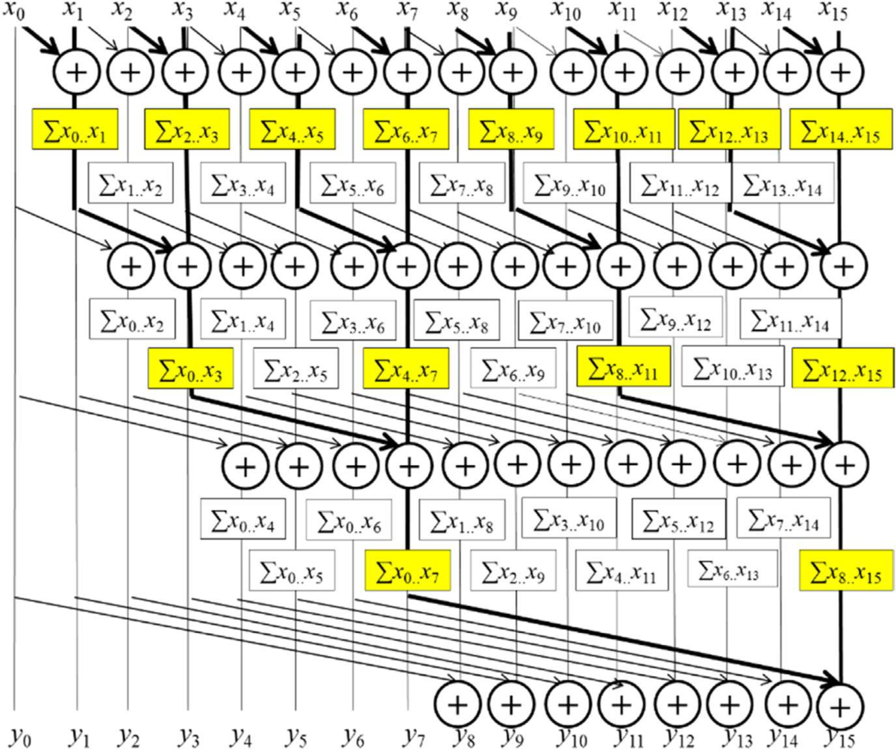
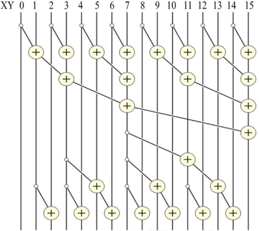
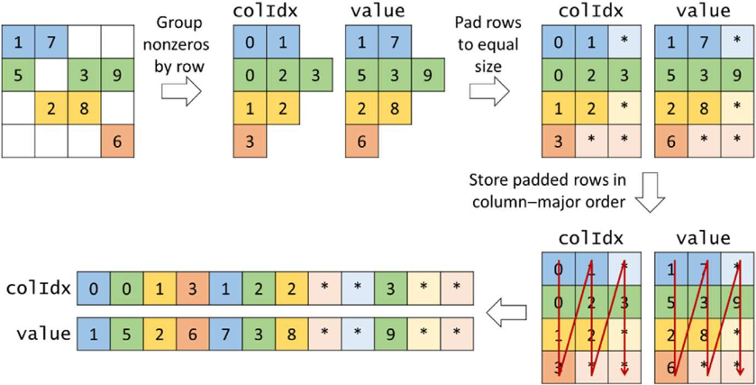
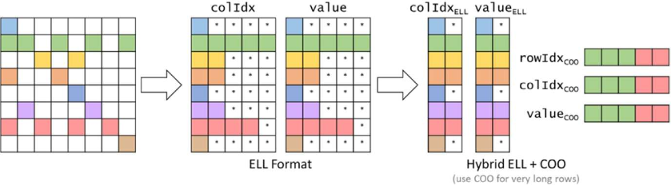
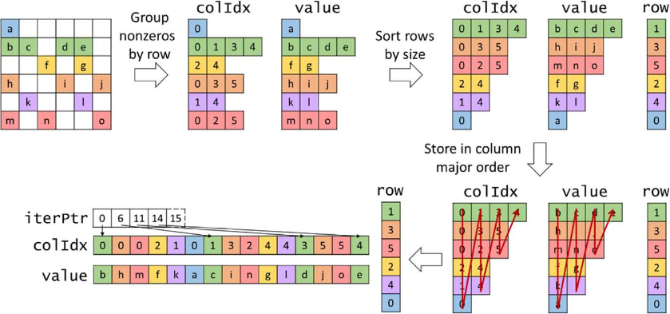

学 cuda, 写点总结

<!--more-->

## 硬件

### 抽象


## 优化

### 合并内存访问

### 平铺

### 线程粗化

## 应用

### 规约

### 归并

### 前缀和

#### Kogge-Stone

没什么好说的, 和树形规约看上去挺像的, 区别在于每次迭代参与的线程是哪些: 规约在每一轮都把一半的数据计算贡献后抛弃, 而前缀和是每一轮计算完成计算完成了前 $2^{offset}$ 的前缀和, 但是不抛弃这些数据, 后续仍会用到

或者看做类似 st 表和 LCA 的倍增算法, 第 `stride` 轮的第 `i` 项代表 `sum([i - 2**stride, i])`



```cpp
__global__ void Kogge_Stone_scan_kernel(float *X, float *Y, unsigned int N){
    __shared__ float XY[SECTION_SIZE];
    unsigned int i = blockIdx.x*blockDim.x + threadIdx.x;
    if(i < N) {
        XY[threadIdx.x] = X[i];
    } else {
        XY[threadIdx.x] = 0.0f;
    }
    for(unsigned int stride = 1; stride < blockDim.x; stride *= 2) {
        __syncthreads();
        float temp;
        if(threadIdx.x >= stride)
            temp = XY[threadIdx.x] + XY[threadIdx.x-stride];
        __syncthreads();
        if(threadIdx.x >= stride)
            XY[threadIdx.x] = temp;
    }
    if(i < N) {
        Y[i] = XY[threadIdx.x];
    }
}
```

也类似 ST 表, 总的计算量是 $\mathrm O(n\log n)$, 对前缀和来说偏大

而且受制于显示中资源的限制, `SECTION_SIZE` 不可能太大, 效率还会进一步下降

#### Brent-Kung

我们实际上无用计算了很多部分, 尤其是 `stride` 小而 `i` 大的部分

考虑怎么减少这部分

- upsweep 就是先构造一个树状数组, `index` 从 `1` 开始的情况下 (很遗憾代码是从 `0` 开始的, 所以接下来会有点混乱), `XY[i]` 存储的就是 `sum(i - lowbit(i), i]`

树状数组的前缀和查询就是 `i -= lowbit(i)` 的 `XY[i]` 循环累加, 逐个累加总计算量还是太高, 考虑通过贡献计算

- downsweep 的过程是使树状数组维护的区间和真正变成前缀和:

假设当前时刻所有 `lowbit(i) >= stride` 的位置都已经完成处理, 即 `XY[i] == pre[i]`; 初始时 `XY[1000..000] == pre[1000..000]` 满足条件

处理 `i` 时需要 `XY[i - lowbit(i)]` 已经完成处理:

注意到, 当 `x = stride` 是 `2` 的幂时, 设 $p = (2n + 1)x$, 则 $\mathrm{lowbit}(p) == x$, $\mathrm{lowbit}(p - x) = 2nx \ge x$

所以 $p - x$ 的位置一定已经完成了处理, `pre[p]` 可以直接由 `XY[p - x] + XY[p]` 得出




```cpp
__global__ void Brent_Kung_scan_kernel(float *X, float *Y, unsigned int N) {
    __shared__ float XY[SECTION_SIZE];
    unsigned int i = 2*blockIdx.x*blockDim.x + threadIdx.x;
    if(i < N) XY[threadIdx.x] = X[i];
    if(i + blockDim.x < N) XY[threadIdx.x + blockDim.x] = X[i + blockDim.x];
    for(unsigned int stride = 1; stride <= blockDim.x; stride *= 2) {
        __syncthreads();
        unsigned int index = (threadIdx.x + 1)*2*stride - 1;
        if(index < SECTION_SIZE) {
            XY[index] += XY[index - stride];
        }
    }
    for (int stride = SECTION_SIZE/4; stride > 0; stride /= 2) {
        __syncthreads();
        unsigned int index = (threadIdx.x + 1)*stride*2 - 1;
        if(index + stride < SECTION_SIZE) {
            XY[index + stride] += XY[index];
        }
    }
__syncthreads();
    if (i < N) Y[i] = XY[threadIdx.x];
    if (i + blockDim.x < N) Y[i + blockDim.x] = XY[threadIdx.x + blockDim.x];
}
```

Brent-Kung 主要减少的是计算次数, 可能使用于限制能耗的场景; 单纯的计算时间可能不如 Kogge-Stone, 毕竟要做两遍计算


### SpMV (*Sparse Matrix-Vector Multiplication*)

一个稀疏矩阵乘一个向量, 一般认为这个向量是稠密的

#### COO (*COOrdinate*)

最简单的形式, 坐标表 `row[n], col[n], val[n]` 记录稀疏矩阵中非 0 位置的坐标和值. 并行处理非 0 值

```cpp
__global__ void SpMV_COO(const coo* matrix, const float* x, float* y) {
    int ind = blockIdx.x * blockDim.x + threadIdx.x;
    if (ind < matrix->size) {
        int row = matrix->row[ind];
        int col = matrix->col[ind];
        float val = matrix->val[ind];
        atomic_add(&y[row], x[col] * val);
    }
}
```

- 空间效率: 高
- 灵活性: 可任意增删元素 
- 可访问性: 简单获取当前元素的行列坐标, 但无法快速遍历某行某列
- 控制发散: 无
- 内存访问: 全部合并
- 由于相同行的值会在不同线程累加到同一个位置, 需要额外的原子操作开销


#### CSR (*Compressed Sparse Row*)

将坐标按所属的行分类. 并行处理所有行, 一行的内容在一个线程内处理, 避免原子操作的开销

```cpp
__global__ void SpMV_CSR(const csr* matrix, const float* x, float* y) {
    int row = blockIdx.x * blockDim.x + threadIdx.x;
    if (row < matrix->row_size) {
        float sum = 0.0;
        for (int i = matrix->row_ptr[row]; i < matrix->row_ptr[row + 1]; i ++) {
            int col = matrix->col[i];
            float val = matrix->val[i];
            sum += x[col] * val;
        }
        y[row] += sum;
    }
}
```

- 空间效率: 高
- 灵活性: 增删元素 需要整体挪动后续坐标
- 可访问性: 简单获取当前元素的行列坐标, 只能快速遍历某行
- 控制发散: 取决于一个 warp 内不同行间非 0 列的长度差异
- 内存访问: 非合并

#### ELL (*ELLPACK 中使用的 SpMV 实现方式*)

将坐标按所属行分组后, 将所有行填充 0 至最长的那一行; 而后存储为列主序的数组; 并行处理所有行



```cpp
__global__ void SpMV_ELL(const ell* matrix, const float* x, float* y) {
    int row  = blockIdx.x * blockDim.x + threadIdx.x;
    if (row < matrix->row_size) {
        float sum = 0.0;
        for (int t = 0; t < matrix->row_non_0_num[row]; t++) {
            int i = t * matrix->row_len + row;
            int col = matrix->col[i];
            float val = matrix->val[i];
            sum += x[col] * val;
        }
        y[row] += sum;
    }
}
```

- 空间效率: 取决于不同行间非 0 列的长度差异 
- 灵活性: 在非最长的一行增加元素可以直接把占位的 0 改为要增加的值; 在最长的一行增加则需要增加全体占位
- 可访问性: 简单获取当前元素的行列坐标, 只能快速遍历某行
- 控制发散: 取决于一个 warp 内不同行间非 0 列的长度差异
- 内存访问: 合并

#### ELL-COO

注意到在有几列相当长的情况下, 填充会带来相当大的内存浪费, 我们可以把超过阈值的几行多出来的部分使用 COO 来存储; 其他部分依旧使用 ELL



#### JDS (*Jagged Diagonal Storage*)

JDS 将不同行按照包含的非 0 列的多少进行排序, 并行处理所有行; 通过排序, 一个 warp 内不同行间的非 0 列长度基本是相近的, 可以减少控制发散; 改为列主序也是为了合并内存访问



代码和 ELL 差不多

排序的消耗可能比较大, 更适合多次使用这一矩阵的情景

### BFS

有并行处理顶点 \/ 边 \/ bfs 队列的

但是我感觉都不如直接用邻接矩阵做矩阵快速幂

可能中间结果矩阵会变稠密, 导致空间上涨
