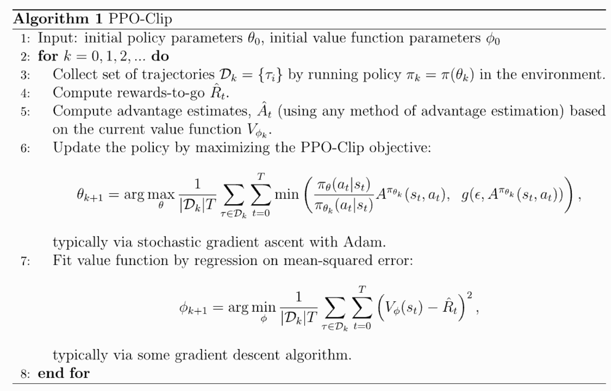

学后训练, 写点总结

说到底训出来不爆炸比什么都强

<!--more-->

## Post Train

都是反向传播梯度下降那一套

在后训练中学习 pre train 中没学到的知识很可能产生幻觉, 一般是学会讲出已经学到的东西

也有一些在 pre train 就掺入 post train 的方法: 例如分 stable 和 decay 两个阶段; stable 还是通用语料训练基础能力, decay 逐渐加入针对性高质量数据

(这不还是相当于 pre train 搞了个小 post train 吗)

长尾但重要的知识更适合扔 rag 里

### SFT (*Supervised Fine-Tuning*)

$p^*(y\mid x)$：参考分布，通常由人工示范数据隐含表示；

$\hat p(y\mid x)$：模型学习到的输出分布。

目标是让 $\hat p(y\mid x) \approx p^*(y\mid x)$, 让模型能够在某种输入下, 按某种格式做输出 (例如思维链)

实际上类似于一个初始值, 避免后续输出的一堆乱七八糟的东西奖励都太低, 没法训练

SFT 只需要少量数据就能对模型产生重大影响: 因为 SFT 的数据针对性更强, 目标和意图更密集

### RLHF (*Reinforcement Learning from Human Feedback*)

目标是最 (实践中不一定追求最值) 大化 $J(\theta) = \max_p \mathbb{E}_{p}[R(y,x)]$

GV gap: 写一篇好文章很难, 评价那篇文章好相对简单

训练时的主要指标: 

- reward 和 评估胜率的关系: 避免 reward hacking
- 置信度 和 正确率的关系: 避免过度自信或者过度自卑; 可以通过调整温度在一定程度缓解

#### Policy gradients

我们需要 $Loss(\theta) = -\nabla_\theta J(\theta)$, 而

$$
\nabla_\theta J(\theta) =\sum_a R(a)\nabla_\theta\pi_\theta(a)
$$

计算导数需要知道每个 $a$ 的概率, 期望的可能选择太多, 无法直接计算

$$
\begin{aligned}
& \nabla_\theta\pi_\theta(a) =\pi_\theta(a)\nabla_\theta\log\pi_\theta(a) \\
\Rightarrow & \nabla_\theta J = \sum_a\pi_\theta(a) R(a)\nabla_\theta\log\pi_\theta(a)
\end{aligned}
$$

$pi_theta(a)$ 是 $a$ 在模型 $\theta$ 出现的概率, 可以将 $\nabla_\theta$ 看做一个期望

$$
\nabla_\theta J = \mathbb E_{a\sim\pi_\theta} \left[R(a)\nabla_\theta\log\pi_\theta(a)\right]
$$

蒙特卡洛法可以通过随机采样估计期望

#### PPO (*Proximal Policy Optimization*)

奖励模型可以通过成对的回答和对这些回答中的哪一个的偏好训练出来

- Actor: 我们要训的模型
- Ref: SFT 后保持不变的模型, 通过限制 Actor 和 Ref 的距离, 可以避免在 PPO 中的破坏性更新
- Reward: 额外训练的模型, 给出当前 token 的奖励
- Critic: 额外训练的模型, 可以根据当前的 token 预计完整输出后能得到的奖励是多少; Critic 会和 Actor 一起训练

critic 有点像 $A^*$ 中的 $h()$, 比较当前的 critic 和输出下一个 token 后的 critic, 就能判断当前 token 是高于预期还是低于预期了

可以用来判断一个回答中哪些 token 导致的 reward 增加

$$
\delta_t=r_t+\gamma V(s_{t+1})-V(s_t)
$$

其中：

- $r_t$：当前步骤获得的实际奖励
- $V(s_t)$：Critic 对当前状态价值的预测
- $V(s_{t+1})$：Critic 对下一状态价值的预测
- $\gamma$：折扣因子

GAE: 单步的 TD 残差只看当前 token 的贡献, 不够有远见; 可以把后续的步骤也加上:

$$
\hat A_t^{\mathrm{GAE}(\gamma,\lambda)}
=\sum_{l=0}^{T-t-1}(\gamma\lambda)^l\delta_{t+l}
$$

PPO 的最终目标是最大化

$$
J(\phi)=
\mathbb{E}_{x,\;y\sim\pi_\phi^{\mathrm{RL}}(\cdot|x)}
\left[
r_\theta(x,y)
-\beta\log\frac{\pi_\phi^{\mathrm{RL}}(y|x)}
{\pi^{\mathrm{SFT}}(y|x)}
\right]
+\gamma\mathbb{E}_{z\sim D_{\mathrm{pretrain}}}
\left[\log\pi_\phi^{\mathrm{RL}}(z)\right].
$$

- $r_\theta(x,y)$ 对应奖励
- $\beta\log\frac{\pi_\phi^{\mathrm{RL}}(y|x)}{\pi^{\mathrm{SFT}}(y|x)}$ 用来避免偏移初始模型太远
- $\gamma\mathbb{E}_{z\sim D_{\mathrm{pretrain}}}\left[\log\pi_\phi^{\mathrm{RL}}(z)\right]$ 用来避免失去预训练中的能力: $z$ 是在预训练文本中的 token 序列, 加这个的期望增加预训练中学到的序列的贡献

TODO

最后, 我们用这个东西来更新 Actor: 

$$
\mathcal{L}_{\text{total}}=\mathcal{L}_{\text{policy}}+c_1\mathcal{L}_{\text{value}}-c_2\mathcal{H}(\pi_\theta)
$$

其中:

$$
\mathcal{L}_{\text{policy}}=-\mathbb{E}_t
\left[
\min
\left(
\rho_t(\theta)\hat{A}_t,\;
\operatorname{clip}
\left(
\rho_t(\theta),1-\epsilon,1+\epsilon
\right)\hat{A}_t
\right)
\right]
$$

$$
\rho_t(\theta)=\frac{\pi_\theta(a_t\mid s_t)}
{\pi_{\text{old}}(a_t\mid s_t)}
$$

$$
\mathcal{L}_{\text{value}}=
\mathbb{E}_t
\left[
\left(
V_\phi(s_t)-\hat{R}_t
\right)^2
\right]
$$

$$
\mathcal{H}(\pi_\theta)=-\mathbb{E}_t
\left[
\sum_a
\pi_\theta(a\mid s_t)
\log\pi_\theta(a\mid s_t)
\right]
$$

#### DPO (*Direct Preference Optimization*)

PPO 太复杂了, 考虑如何优化

DPO 不需要奖励模型, 直接利用对回答的偏好设计 loss, 使得模型模型可以更倾向给出偏好的回答

我们可以发现, 模型肯定满足约束 $\sum_y \pi(y\mid x)=1$, 对 $J(\phi)$ 做 拉格朗日乘子

$$
\mathcal{L}=
\sum_y \pi(y\mid x)r(x,y)-\beta\sum_y \pi(y\mid x)
\log\frac{\pi(y\mid x)}{\pi_{\mathrm{ref}}(y\mid x)}+\lambda\left(\sum_y \pi(y\mid x)-1\right).
$$

TODO

经过这些操作, 可以得到最终 loss:

$$
\boxed{
\begin{aligned}
\mathcal{L}_{\mathrm{DPO}}(\theta)
={}&-\mathbb{E}_{(x,y_w,y_l)\sim\mathcal{D}_{\mathrm{pref}}}
\Bigg[
\log\sigma\Bigg(
\beta\log\frac{\pi_\theta(y_w\mid x)}
{\pi_{\mathrm{ref}}(y_w\mid x)}
\\
&\qquad\qquad
-\beta\log\frac{\pi_\theta(y_l\mid x)}
{\pi_{\mathrm{ref}}(y_l\mid x)}
\Bigg)
\Bigg].
\end{aligned}
}
$$

#### GRPO (*Group Relative Policy Optimization*)

