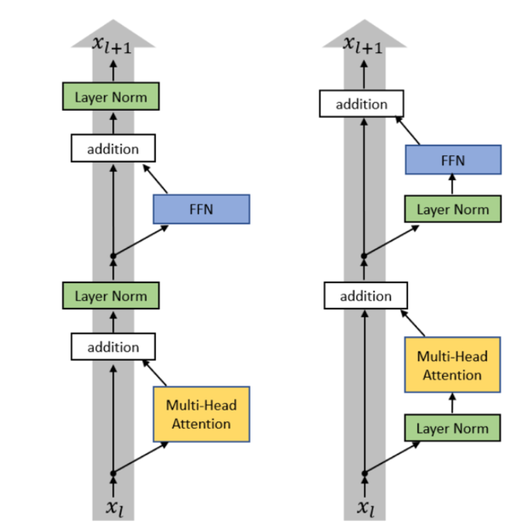
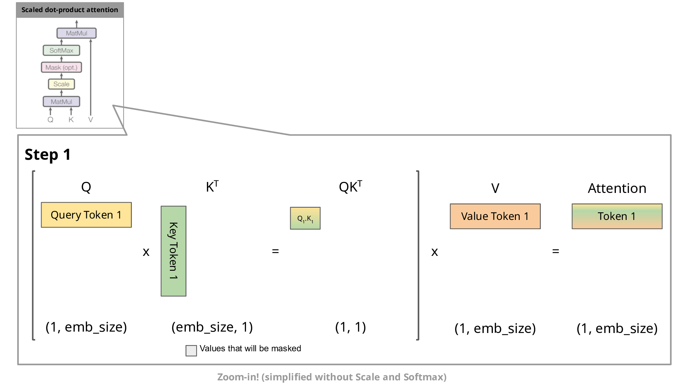

学变形金刚, 写点总结

哎 怎么突然好像就要被时代碾死了

<!--more-->

# Tokenizer

## Character-based tokenization

没什么好说的, 就是 Unicode character 和 码点 的一一转换

压缩率取决于 Unicode

词表太大了, 不常用的 character 浪费空间

## Byte-based tokenization

按字节分词原样存, 词表大小 256

压缩率为 1, 太小了

## Word-based tokenization

按单词分词

```python
segments = regex.findall(r"\w+|.", string)  # @inspect segments
```

词表太大, 不常用的词浪费空间

## BPE (*Byte Pair Encoding*)

先按字节原样存, 然后按已知的 word 中不同 token 连续出现的概率, 从大到小合并 token

```python
def train_bpe(string: str, num_merges: int) -> BPETokenizerParams:  # @inspect string, @inspect num_merges
    # Start with the list of bytes of string.
    indices = list(map(int, string.encode("utf-8")))  # @inspect indices
    merges: dict[tuple[int, int], int] = {}  # index1, index2 => merged index
    vocab: dict[int, bytes] = {x: bytes([x]) for x in range(256)}  # index -> bytes
    for i in range(num_merges):
        # Count the number of occurrences of each pair of tokens
        counts = defaultdict(int)
        for index1, index2 in zip(indices, indices[1:]):  # For each adjacent pair
            counts[(index1, index2)] += 1  # @inspect counts
        # Find the most common pair.
        pair = max(counts, key=counts.get)  # @inspect pair
        index1, index2 = pair
        # Merge that pair.
        new_index = 256 + i  # @inspect new_index
        merges[pair] = new_index  # @inspect merges
        vocab[new_index] = vocab[index1] + vocab[index2]  # @inspect vocab
        indices = merge(indices, pair, new_index)  # @inspect indices
    return BPETokenizerParams(vocab=vocab, merges=merges)
```

# 学习

## Init

对于 $y = x_{d}W_{d\times d}$, 假设 $x_i\sim \mathcal{N}(0,1), \, W_{ij}\sim \mathcal{N}(0,1)$ 且相互独立

由 $\operatorname{Var}(aX+bY)=a^2\operatorname{Var}(X)+b^2\operatorname{Var}(Y)$ 和 $\operatorname{Var}(XY) =E[X^2Y^2]-(E[XY])^2$

$$
\begin{aligned}
\operatorname{Var}(y_j)
&=\operatorname{Var}\left(\sum_{i=1}^{d}x_iW_{ij}\right)\\
&=\sum_{i=1}^{d}\operatorname{Var}(x_iW_{ij})\\
&=d\\
\operatorname{Std}(y_j)&=\sqrt{d}
\end{aligned}
$$

为了避免方差随维数增长而增长导致的梯度不稳定, 初始化的时候一般会使用 `w = nn.Parameter(torch.randn(input_dim, output_dim) / np.sqrt(input_dim))`

Attn 中的分母原因也是类似的

## 反向传播

- 总得来说就是保存计算图, 然后链式法则, 基础操作查表

- 一般认为反向传播的计算量是前向的两倍:

    对于线性层 $Y=XW$, 前向传播需要一次矩阵乘法, 而反向传播需要两次矩阵乘法: 
    
    $$
    \begin{aligned}
    \frac{\partial L}{\partial W}&=X^T\frac{\partial L}{\partial Y}\\
    \frac{\partial L}{\partial X}&=\frac{\partial L}{\partial Y}W^T
    \end{aligned}
    $$
    
    其实主要就是前一层的梯度计算需要这一层的 $\frac{\partial L}{\partial X}$, 所以得多算一个

## 优化器

没什么好说的, 主要就是要避免震荡和学不了东西

- SGD (*Stochastic Gradient Descent*): $\theta_{t+1}=\theta_t-\eta g_t$, 随机指的是 Loss 是由随机抽取的样本得出的
- Momentum: 令 $v_t=\beta v_{t-1}+g_t$, 更新: $\theta_{t+1}=\theta_t-\eta v_t$
- AdaGrad: 令 $G_t=G_{t-1}+g_t^2$, 更新: $\theta_{t+1} = \theta_t- \frac{\eta}{\sqrt{G_t}+\epsilon}g_t$
- RMSProp: 令 $s_t=\beta s_{t-1}+(1-\beta)g_t^2$, 更新: $\theta_{t+1} = \theta_t- \frac{\eta}{\sqrt{s_t}+\epsilon}g_t$
- Adam:
$$
\begin{aligned}
m_t&=\beta_1m_{t-1}+(1-\beta_1)g_t\\
v_t&=\beta_2v_{t-1}+(1-\beta_2)g_t^2\\
\hat m_t&=\frac{m_t}{1-\beta_1^t}\\
\hat v_t&=\frac{v_t}{1-\beta_2^t}\\
\theta_{t+1} &= \theta_t- \eta\frac{\hat m_t}{\sqrt{\hat v_t}+\epsilon}
\end{aligned}
$$ 

# 残差网络

学差值 $H(x) - x$ 比直接学目标值 $H(x)$ 效果好

- 直接学 $H(x)$ 很难学习到恒等映射
- 梯度问题

## Norm

传统 postNorm 放在残差 $H(x)$ 和 $x$ 相加之后, 现在基本都使用 preNorm: 放在进入 $H(x)$ 之前



好处是避免像 postNorm 一样层数多的时候求梯度时会出现多个矩阵连乘可能导致的梯度问题 $\frac{\partial x_L}{\partial x_0} = \prod_{l=0}^{L-1} J_{\operatorname{LN},l}(I+J_{F,l})$, 坏处是 $x$ 本身不经过 Norm

- LayerNorm: $y_i=\frac{x_i-\mu}{\sqrt{\sigma^2+\epsilon}}$
- RMSNrom: $y_i=\frac{x_i}{\sqrt{\frac{1}{d}\sum_{i=1}^{d}x_i^2+\epsilon}}$, 其中 $RMS(x)=\sqrt{\frac{1}{d}\sum_{i=1}^{d}x_i^2}=\sqrt{\mathbb{E}(X^2)}=\sqrt{\operatorname{Var}(X) + \mathbb{E}(X^2)}$, RMSNorm 一般用在 $H(X)$ 路径上, 保留偏差是有必要的, 所以不用减均值, 也因此计算量更小

不减偏置还有一个好处就是减小访存压力, 虽然 FLOPS 没多少, 但是访存带来的时间消耗占比挺大的; 其实 FFN 也没什么人加偏置了, 效果有限 $\mathrm{FFN}(x) = \sigma(xW_1+b_1)W_2+b_2 \to \mathrm{FFN}(x) = \sigma(xW_1)W_2$

## FFN (*Feed-Forward Network*)

升维 激活 降维

### 激活函数

太多了, 是因为好水论文吗

### MoE

一个大 FFN 效率太低了, 拆成多个, 由 router 判断每个 token 用哪(些)个专家, 然后合并结果

好像还有对 attn 搞 MoE 的, 比较少

共享专家: 每个 token 都经过的大 FFN; 实测似乎没什么效果

#### router

- topK: 每个模型一个可训练的向量, 每个 token 和这个向量做运算得出权重, 挑出 top K 个专家, softmax 权重; 然后每个专家的结果对权重加权求和
- hash: 战力计算单位
- RL to learn routes: 现在没什么人用了
- 整体分派: 把一组 token 看做一个整体, 让整体的分数尽可能高


## 位置编码

## Attention

### flash attention

先定义下常用变量

$$
\begin{flalign*}
Q_{N \times d} &= X_{N \times d_{token}}W_{d_{token} \times d} && \\
O_{N \times d} &= \mathrm{attn} = \mathrm{softmax}(\frac{QK^T}{\sqrt{d}})V && \\
S_{N \times N} &= \frac{QK^T}{\sqrt{d}} && \\
P_{N \times N} &= \mathrm{softmax}(S) && \\
m_{N \times 1} &= \mathrm{rowmax}(S) && \\
l_{N \times 1} &= \mathrm{rowsum}(\exp(S - m)) && \\
O_{N \times d} &= PV && \\
\end{flalign*}
$$

`safe_softmax(X)[i] = expf(X[i] - max(X)) / sum( expf( X[i] - max(X) ) )`

$N$ 通常很大, 考虑分 Tile

$Q, O$ 分 $T_r = \frac{N}{B_r}$ 片, $Q_i, O_i: B_r \times d$

$K, V$ 分 $T_c = \frac{N}{B_c}$ 片, $K_i, V_i: B_c \times d$

$m, l$ 分 $T_r$ 片, $m_i, l_i: B_r \times 1$

#### V1

考虑要得到 $O_{i, j}$ 的话, 需要 $P_{i, :} \cdot V_{:, j}$

而 $P_{i, :}$ 需要 

$$
\frac{\exp(\frac{1}{\sqrt{d}} \times Q_{i, :} \times K^T  - m_i)}{l_i}
$$

$K_{N \times d}$ 按 $N$ 方向分片后, $K^T$ 被分成了横向的几块, 每一列是被完整保存的

```
          K^T
     ┌────┬────┬────┬─────┐
     │    │    │    │     │
     │  1 │  2 │ .. │ T_c │
     │    │    │    │     │
     └────┴────┴────┴─────┘
```

$Q_{N\times d} \times K^T_i$ 是最终 $Q \times K^T$ 的一部分, 在经过**全局** softmax 处理后, 这部分 乘上 $V_i$ 就是 $O_{N\times d}$ 的一部分贡献

(当然每次循环的时候我们是没有全局 softmax 的, 所以需要 online softmax 的技术去算贡献)

要求最终值只需要把不同 $K V$ 块得出的 $O$ 加起来即可

```
for each K/V block:
    load K[j],V[j]

    for each Q block:
        load Q[i], O[i], l[i], m[i] // 这里读取 l 和 m, 将来 K^T 向右遍历的时候需要更新他们
        compute
        store O, l, m
```

$Q$ 和 $O$ 也太大, 需要分块, 所以内层是 $Q$ 和 $O$ 用同一个坐标和块数; 实际上将整个内层循环看成一个整体, 我们可以当他是一个完整的 $Q$ 和 $O$

#### V2

我们发现 K V Tile 的每次迭代, 要读一遍 Q O l m, 写一遍 O l m, 内存内存太贵了, 考虑怎么优化

K V 是只读的, 不需写入, 交换 K V 循环到里层的话, 访问 K V 的次数变多了, 但是写入 O l m 的次数少了

```
for each Q block:
    load Q
    init O, l, m

    for each KV block:
        load K,V
        update O, l, m

    store O
```

##### split K -> split Q

V1 对 K 的行做并行, 每个 warp 只能拿到一部分贡献, 还需要 shared mem 做最终计算

Q 的行间是独立的, 改为对 Q 的行做并行, 每个 warp 都能拿到最终数据, 可以避免 shared mem 的消耗

#### V3

Hopper 增加了 TMA 和 Tensor Core, 和 Cuda Core 可以并行运行

因此改为 producer warp 加载到 Tensor Core 需要的地方, consumer warp 直接获取 Tensor 的矩阵计算结果


[参考](https://zhuanlan.zhihu.com/p/2068355332049522938)


### KV Cache



### MHA

MHA 在 decode 时的算数强度太差了 ($bnd^2$ 次计算, 读之前的 KV 和计算当前 KV 读取投影矩阵 $W_K, W_V$ 总共需要 $bn^2d + nd^2$ 次访存), 考虑怎么优化

#### MQA

把 KV 都只保留一个头, 访存就少了 ($bnd + bn^2\frac{d}{h} + nd^2$)

Q 依然保持 h 个头, 每个头分别和 KV 做 attn, 结果 concat 起来

质量可能下降

#### GQA

多给 KV 留几个头, 每个头固定对应一个范围的 Q 的头

然后和 MQA 差不多

质量下降的少点 总之就是取舍

#### MLA (*Multi-Head Latent Attention*)

存储时降维, 压缩 KV 的维数, 计算时再升回来

有点像 FFN; 或者说类似 Block Floating Point, 抽出来一个 $c^{KV}$

$$
q_i^\top k_i
=q_i^\top W_i^{UK}c^{KV}
=\left((W_i^{UK})^\top q_i\right)^\top c^{KV}
$$

(那为什么不直接把 QKV 的维数超参数降下来)

这个过程中对位置编码有一些要求

### Linear attention

$attn = \rho(QK^T)V$

attention 计算和空间大主要都是因为 $Q_{n\times d}K^T$ 得出来的那个 $n\times n$ 大矩阵

如果 $\rho$ 是恒等变化, $(QK^T)V = Q(K^TV)$, 就简单多了 ($2nd_kd_v$)

还有更好的性质: 考虑 $O$ 每一行 (也就是每个 token) $o_t$ 的计算过程

(学术上一般把 $q_t$ 看做 $Q$ 的第 $t$ 行的**列**表示, $q_t^T$ 才代表 $Q$ 的某一行, $k_t, v_t$ 同理; 我感觉有点扯淡, 下文还是直接用 $q_t$ 代表第 $t$ 行)

$$
\begin{aligned}
s_t &= \frac{1}{\sqrt{d}}(QK^T)_t = \frac{1}{\sqrt{d}}(q_tK^T) \\
o_t &= \frac{1}{\sqrt{d}}s_tV \\
&= \frac{1}{\sqrt{d}}\begin{bmatrix} q_tk_1^T & \cdots & q_tk_N^T \end{bmatrix} \begin{bmatrix} v_1\\ \vdots\\ v_N \end{bmatrix} \\
&= \frac{1}{\sqrt{d}}\sum_{i=1}^{N}(q_tk_i^T)v_i \\
&= \frac{1}{\sqrt{d}}q_t\sum_{i=1}^{N}k_i^Tv_i
\end{aligned}
$$

我们设 $S_t = \sum_{i=1}^{t}k_i^Tv_i$, 则 $o_t = \frac{1}{\sqrt{d}}q_tS_t$, 且 $S_t = S_{t - 1} + k_t^Tv_t$

有点像 RNN

可以加一点遗忘: $S_t = \gamma S_{t - 1} + k_t^Tv_t$

一般把线性注意力和全注意力掺和着用, 效果差的不会太大

### Sparse attention

### Sliding window attention

